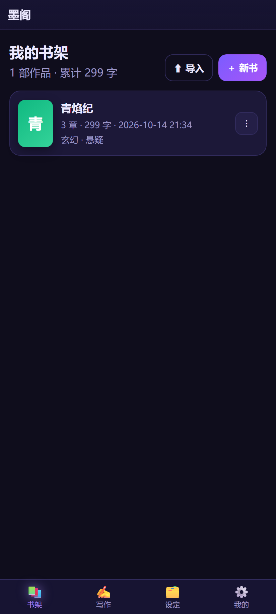

# 墨阁 · AI 小说工作室

一个**手机优先**的写小说 App，用 Chrome 的「安装应用 / 添加到主屏幕」装到手机上，像原生 App 一样全屏、离线打开。
接入你自己的 AI 接口（DeepSeek、Kimi、智谱、通义、硅基流动、OpenRouter、OpenAI、Claude、Gemini、本地 Ollama…）来续写、润色、扩写、出大纲、查矛盾。

- 纯前端，**默认没有任何后端服务器**，小说和 API Key 只存在这台手机的浏览器里
- 数据存 IndexedDB，**离线也能正常写作**（AI 功能需要联网）
- **多设备云同步**：手机写的换电脑接着写，支持 GitHub Gist / 自建 Worker / 坚果云 WebDAV；两端冲突自动留副本，不丢字
- **导入导出走同一套 Markdown 标准格式**：能把手头的 txt 搬进来（AI 自动分章 + 补全设定），也能导出给 AI 读写的标准书稿
- 支持导出 TXT / Markdown、整库 JSON 备份与恢复



---

## 一、5 分钟上手

### 第 1 步：把文件放到一个 https 地址上（任选一种）

> 手机 Chrome 只有在 **https**（或 localhost）下才会提供真正的「安装应用」。局域网 http 也能用，但装出来只是普通快捷方式。

**方式 A：Netlify Drop（最省事，30 秒）**
1. 电脑浏览器打开 <https://app.netlify.com/drop>
2. 把整个 `novel-studio` 文件夹直接拖进页面
3. 等几秒，得到形如 `https://xxxx.netlify.app` 的网址 → 发给手机

**方式 B：GitHub Pages（免费、稳定、可长期用）**
1. 新建一个仓库，把 `novel-studio` 里的文件全部上传（不要外层文件夹也行）
2. 仓库 → Settings → Pages → Source 选 `Deploy from a branch`，Branch 选 `main` + `/ (root)`，保存
3. 一两分钟后访问 `https://你的用户名.github.io/仓库名/`

**方式 C：Vercel / Cloudflare Pages** 同理，把文件夹拖进去或连仓库即可。

### 第 2 步：手机上安装

**安卓 Chrome**
1. 用 Chrome 打开上面的网址
2. 右上角 `⋮` → **安装应用**（有的版本显示「添加到主屏幕」）
3. 桌面出现「墨阁」图标，点开就是全屏 App

**iPhone Safari**
1. 用 **Safari**（不是 Chrome）打开网址
2. 底部「分享」按钮 → **添加到主屏幕**

App 内「我的 → 安装到手机」也有同样的按钮和状态提示。

> ⚠️ **安卓 Chrome 点安装后长时间转圈、最后失败？** 这是**网络问题，不是项目问题**，见下面第 2.1 节。

### 第 2.1 步：装不上怎么办（国内常见）

**先确认项目没问题。** 用体检脚本跑一次：

```bash
node server.mjs &          # 或先部署到 https
node tools/pwa-doctor.mjs  # 也可以用线上地址：node tools/pwa-doctor.mjs https://你的网址/
```

它会把 manifest 字段、图标真实尺寸、Service Worker、预缓存资源、以及 **Chrome 官方的安装性检查**逐条列出来。
如果结论是「项目文件本身没有安装性障碍 ✅」，那失败就出在下面这一步：

**原因**：安卓 Chrome 的「安装应用」不是建快捷方式 —— 它要把网页发给 **Google 的服务器**
（`webapk.googleapis.com`）打包成真正的 APK（WebAPK），再下载回手机安装。
国内网络连不上 Google，就会一直转圈然后报失败。体检脚本会顺便实测这三个域名是否可达。

**三种解法**（按省事程度）：

| 办法 | 做法 | 适用 |
| --- | --- | --- |
| ① 装的时候挂一次代理 | 连上代理再点「安装应用」，**装完就能关**，装好的 App 不再需要 Google | 手头有代理，最省事 |
| ② 打包成 APK 直接装 | 电脑打开 <https://www.pwabuilder.com> → 输入网址 → Android → 下载签名好的 `.apk` → 传到手机安装（允许「未知来源」）。想要全屏无地址栏，把生成包里的 `assetlinks.json` 放到你网站的 `/.well-known/assetlinks.json` | **不经过 Google，最可靠** |
| ③ 换个浏览器建快捷方式 | 手机自带浏览器 / Firefox 的「添加到主屏幕」是本地创建的，不依赖 Google | 只想要个桌面入口 |

另外两点：

- **局域网地址 `http://192.168.x.x:5173/` 装不了** —— 不是 https（安全上下文），Chrome 根本不会提供「安装应用」。要装必须用线上 https 地址。
- **装不上完全不影响使用**：网址收藏到桌面，功能一模一样，数据也都在。

App 内「我的 → 安装到手机 → 装不上？点这里看排查」有同样的说明。

### 第 3 步：填 AI 接口

打开「我的 → AI 接口」：

| 项目 | 怎么填 |
| --- | --- |
| 服务商 | 先选一个（推荐 DeepSeek，便宜好用） |
| 接口地址 | 选服务商后会自动填好 |
| API Key | 去对应官网申请，粘贴进来 |
| 模型 | 会自动填，也可点右边的 `⇩` 拉取可用模型列表 |

点 **测试连接**，显示「连接成功，模型回复：正常」就通了。

---

## 二、各服务商速查

| 服务商 | 申请地址 | 推荐模型 | 浏览器直连 |
| --- | --- | --- | --- |
| DeepSeek | platform.deepseek.com | `deepseek-chat` | ✅ 实测可用 |
| 智谱 GLM | open.bigmodel.cn | `glm-4-flash`（免费）/ `glm-4-plus` | ✅ 实测可用 |
| 通义千问 | bailian.console.aliyun.com | `qwen-plus` | ✅ 实测可用 |
| 硅基流动 | siliconflow.cn | `Qwen/Qwen2.5-7B-Instruct` | ✅ 实测可用 |
| OpenRouter | openrouter.ai/keys | `deepseek/deepseek-chat-v3.1:free` | ✅ 实测可用 |
| Kimi 月之暗面 | platform.moonshot.cn | `moonshot-v1-8k` | ❌ 需代理 |
| OpenAI | platform.openai.com | `gpt-4o-mini` | ⚠️ 视网络，失败就用代理 |
| Google Gemini | aistudio.google.com/apikey | `gemini-2.0-flash` | ⚠️ 视网络，失败就用代理 |
| Anthropic Claude | console.anthropic.com | `claude-sonnet-4-5` | ❌ 需代理 |
| 本地 Ollama | 电脑装 ollama | `qwen2.5:7b` | 仅电脑本地可直连 |

> 「浏览器直连」= 网页直接请求服务商接口。标 ❌/⚠️ 的需要走下面的代理。
> 表格为 2025 年在国内网络下的实测结果，服务商策略可能变化，以「测试连接」的结果为准。

### 遇到 `网络请求失败：可能是服务商不允许浏览器直连（CORS）…`

这就是被浏览器安全策略拦住了。三种解法，**推荐第一种**：

**① 部署免费的 Cloudflare Worker 代理（手机在 4G 下也能用）**

1. 注册 <https://dash.cloudflare.com>（免费）
2. 左侧 **Workers & Pages → Create → Worker**，起个名字，创建
3. 把本仓库 `proxy/cloudflare-worker.js` 的内容整段粘贴进去，替换默认代码，**Deploy**
4. （建议）在 Worker 的 **Settings → Variables** 加一个环境变量 `TOKEN`，值随便一串随机字符
5. 复制 Worker 地址，回到 App「我的 → 高级选项 → CORS 代理」，填：
   - 没设 TOKEN：`https://你的worker.workers.dev/?url=`
   - 设了 TOKEN：`https://你的worker.workers.dev/?token=你的口令&url=`
6. 再点「测试连接」

**② 用电脑起本地服务器（手机和电脑连同一 Wi-Fi）**

```bash
cd novel-studio
node server.mjs          # 或 npm start
```

终端会打印 `手机访问: http://192.168.x.x:5173/`，手机打开它；
CORS 代理填 `http://192.168.x.x:5173/__proxy?url=`（把 IP 换成终端里显示的）。
缺点：电脑必须开着，且只能在同一个 Wi-Fi 下用。

**③ 换一个允许直连的服务商**，比如 DeepSeek / 智谱 / 通义 / 硅基流动 / OpenRouter。

---

## 三、怎么用 AI 写作

写作页右上角 `✦` 打开 AI 助手，14 个动作：

| 动作 | 作用 |
| --- | --- |
| ✍️ 续写 | 按现有情节接着往下写（最常用） |
| 📖 写整章 | 根据设定和大纲写完整一章 |
| ✨ 润色 | 选中一段，保留原意改得更顺更有画面感 |
| ➕ 扩写 / ✂️ 精简 | 把段落写厚 / 压缩节奏 |
| 🔁 改写 / 💬 加对话 | 换一种写法，避免套路；把叙述改成对话 |
| 🗺️ 大纲 / 🧭 剧情走向 | 全书三幕大纲；3 个后续走向 + 利弊 |
| 🎭 角色卡 / 🏷️ 起名 | 设计立体角色；人名地名组织名 |
| 🔍 设定体检 | 找出与前情矛盾、逻辑漏洞、烂套路 |
| 📝 章节摘要 | 生成一两句前情摘要，**存进设定页喂给后续 AI** |
| 💡 灵感 | 卡文时给 5 个能立刻写的桥段 |

**让 AI 越写越像你的三个关键**

1. **设定页填细一点**：世界观、文风要求、角色卡（性格 + 说话方式 + 目标）。这些每次都会自动发给 AI。
2. **每写完一章，点「📝 章节摘要」**，生成后会自动存入该章摘要。AI 靠它记住前情，不会前后矛盾。
3. **选中文字再用**：选中一段后点「润色/扩写/改写」，AI 只处理选中部分，不跑偏。

生成的内容可以先在输出框里改，再选：
**追加到本章末尾** / **插入到光标处**（适合插在段落之间）/ **替换选中** / **复制**。
没写够就点 **继续写**，它会接着刚才的输出往下续。

---

## 四、多设备云同步

手机写到一半，换电脑接着写 —— 「我的 → 云同步」把整本书库上传到云端，另一台设备连同一个云端就能拉下来。

**同步前会自动保存当前章节**；同一章在两端都被改过时，保留较新的那版，另一版自动存成「冲突副本」，**一个字都不会丢**。删除也会同步（用墓碑记录），不会出现"删了又被另一台设备传回来"。

三种云端，按省事程度排：

### 1. GitHub Gist（推荐，浏览器可直连）

1. 打开 <https://github.com/settings/tokens> → **Generate new token (classic)**，只勾 **`gist`** 这一个权限
2. 复制生成的 `ghp_...`，填进 App 的「GitHub Token」
3. **Gist ID 留空**，第一次点「立即同步」会自动创建一个私有 Gist，之后一直用它

> 换设备时：在新设备上填**同一个 Token** 和**同一个 Gist ID**（在自己的 Gist 列表里能找到），点同步即可。
> 一个 Gist 文件有 1MB 限制，墨阁会先 gzip 再上传（约压到 1/8），百万字级别的长篇也放得下；实在太大就按书拆成多个 Gist。

### 2. 自建同步端点（Cloudflare Worker + KV，免费、不依赖第三方账号）

1. 按上面第二节 ① 建好 Worker（用 `proxy/cloudflare-worker.js`），它同时提供代理和同步两个功能
2. Cloudflare 控制台 → **Storage & Databases → KV → Create namespace**，名字随意
3. 回到 Worker → **Settings → Bindings → Add → KV Namespace**，**变量名必须填 `MOGE_KV`**，选中刚建的命名空间，保存并重新 Deploy
4. App 里选「自建同步端点」，**同步地址**填 `https://你的worker.workers.dev`（注意结尾不要带 `?url=`）
5. **房间号**随便起一个（点右边的 🎲 生成），**多台设备填一模一样的房间号**即可
6. 如果 Worker 设了 `TOKEN` 环境变量，把同样的值填进「访问令牌」

> 访问 `https://你的worker.workers.dev/health` 能看到 `{"ok":true,"kv":true}` 就说明绑好了。

### 3. WebDAV（坚果云 / Nextcloud / 群晖）

适配器已实测可用，但**坚果云等不接受浏览器直连，必须填 CORS 代理**（用上面的 Worker 或本机 `server.mjs`）。

以坚果云为例：

1. 网页端登录坚果云 → 右上角头像 → **账户信息 → 安全选项 → 添加应用密码**，拿到一串应用密码
2. 在坚果云里新建一个文件夹，比如「墨阁」，地址就是
   `https://dav.jianguoyun.com/dav/墨阁/moge-sync.json`（**最后一段是文件名，会由墨阁创建**）
3. App 里选「WebDAV」，填地址、坚果云登录邮箱、应用密码
4. **CORS 代理地址**填 `https://你的worker.workers.dev/?url=`（或局域网时的 `http://192.168.x.x:5173/__proxy?url=`）
5. 点「测试连接」，显示「已连通 WebDAV」即可

### 关于同步的几点说明

- **AI 配置（API Key）不同步**，每台设备各自填一次 —— 密钥只留在本机，更安全
- 「自动同步」默认关闭。开启后在有改动的情况下按你选的间隔（2/5/15 分钟）自动同步，切到后台时也会同步一次
- 三个按钮的区别：**立即同步**＝双向合并（日常就用它）；**仅上传**＝把本机覆盖到云端；**仅下载覆盖本机**＝用云端覆盖本机（本机独有作品会被删，慎用）
- 同步状态里会显示云端有多少部作品、多少章、本次上传多少 KB，以及处理了几处冲突
- 换了云端地址、或想强制重新全量比对时，点「重置同步基线」

---

## 五、数据与备份

- 所有作品存在浏览器 **IndexedDB**（`moge-novel`）里，API Key 存在 localStorage
- **不会上传到任何服务器**；AI 请求只发给你选定的服务商
- ⚠️ **清理浏览器数据会把小说一起清掉**。请定期「我的 → 数据 → 备份全部数据(JSON)」，文件在手机「下载」里
- 备份含 API Key，别乱发给别人；换手机时用「从备份恢复」一步迁过去
- 导出 TXT 可直接发到网文平台或微信；Markdown 适合自己排版

### 会占多大空间？（不会无限增长）

「我的 → 数据 → 存储占用」会列出构成，实测长这样：

```
存储占用：359.0 KB（浏览器配额 10240.35 MB）
· 小说正文：2.9 KB —— 1 部作品 / 3 章
· 同步基线：0 B（还没开云同步）
· 其他元数据：568 B —— 共 4 项，其中写作统计 1 天 12 B
· App 离线缓存：332.3 KB —— 14 个文件
```

四部分各自的上限：

| 部分 | 会不会一直涨 | 说明 |
| --- | --- | --- |
| 小说正文 | 跟着字数线性涨 | 这就是你的作品本身，约 **1 万字 ≈ 30 KB** |
| 同步基线 | **有上限**：约等于一份全书副本 | 只留最近一次同步的快照（用于冲突比对），不会累积多份。不开云同步就是 0 |
| 写作统计 | 每天 1 条、每条约十几字节 | 一年约 5 KB，可以忽略 |
| App 离线缓存 | **固定**约 300 KB | Service Worker 缓存的应用外壳，版本更新时会替换旧的 |

**结论**：不会因为日志或缓存越用越大。浏览器给这类站点的配额通常是**磁盘剩余空间的一大部分**（上面例子是 10 GB），写作应用远远用不到。
墨阁运行期间**不写任何日志文件**，控制台输出只在开发者工具里，不落盘。

真正要防的是另一件事：**浏览器"清除站点数据"会连小说一起清掉**，所以请定期备份。

---

## 六、导入书籍与书稿格式

### 导入（书架 →「⬆ 导入」）

三种输入都吃：

- **墨阁标准书稿**（.md / .txt）→ 完整还原书名、题材、视角、简介、世界观、文风、角色卡、章节摘要
- **别人的分章文本** → `第一章` / `第1章` / `Chapter 1` / `3. 标题` 都能认出来
- **一坨没分章的正文** → 勾上「强制用 AI 重新分章」，AI 会分块读完，自动分章并起章节名

导入面板三步：

| 步骤 | 说明 |
| --- | --- |
| ① 选择文件 / 粘贴正文 | 支持 `.txt` `.md`，也可以直接把正文粘进去 |
| ② 关键词（可选） | 例如「玄幻 复仇 铸剑师 慢热」，AI 据此判断题材、视角和角色定位 |
| ③ AI 处理 | 补全设定（书名/题材/视角/简介/世界观/文风/角色卡）· 生成每章摘要 · 强制重新分章 |

- AI 处理是**可选的**：没配接口也能导入，标准书稿会被完整解析，只是没分章的文本会整篇变成第 1 章
- 每一步都会实时打在日志里，AI 在干什么一目了然
- **导入只新增一本书，不会动你已有的作品**
- 长篇会**分块处理**（每块约 6000 字），章节号跨块连续，不会重复编号

### 书稿格式（墨阁标准，纯文本）

导入导出用同一个格式，`.md` 和 `.txt` 内容完全一样：

```markdown
# 青焰纪

- 题材：玄幻 · 悬疑
- 视角：第三人称有限视角
- 一句话简介：落魄铸剑师沈青焰为了找回被夺走的记忆，混入仙门做卧底。
- 文风要求：短句为主，画面感强
- 单章目标字数：2000

## 世界观设定

九州之上，仙门以「剑契」御剑。剑契一断，持剑者便失去相关记忆。

## 角色卡

### 沈青焰
- 身份：铸剑师
- 性格：表面懒散爱开玩笑，实则记仇
- 目标：找回被夺走的记忆
- 其他：左手腕有一道环形旧疤

## 第一章 断契

> 摘要：沈青焰在废剑冢捡到一柄没开锋的剑，剑上刻着自己的名字。

雨下了一夜。
```

规则：

- 第一行 `# 书名`，紧接着是 `- 键：值` 的设定清单
- `## 世界观设定`、`## 角色卡` 是固定小节，不写也行；角色卡里每个角色一个 `### 角色名`
- 每章一个二级标题 `## 第N章 章节名`，下面可以跟一行 `> 摘要：…`
- 正文里要以 `#` 开头的行，写成 `\#` 转义（导出时自动处理）
- 不要用表格、代码块、链接等其他 Markdown 语法

**导出三种**（我的 → 数据）：

| 按钮 | 用途 |
| --- | --- |
| 标准书稿 .md | 给 AI 读写、存档、版本管理（推荐） |
| 标准书稿 .txt | 同上，只是扩展名不同，内容一模一样 |
| 纯正文 .txt | 投稿、发网文平台用，去掉全部标记 |

> 导入时会做**宽容解析**：`《书名》`、`题材：xxx`（没有 `-`）、`【世界观设定】`、`【第一章 …】`、`【角色名】` 这些 AI 和手写常见的变体都能认。

### 让别的 AI 也按这个格式干活

「我的 → 数据 → **书稿格式说明**」会把整套规范连示例一起复制到剪贴板 —— **直接贴给任何模型**：

- 让它**生成**新书稿，导进来就能用
- 让它把手里乱七八糟的文本**整理成标准格式**，再导入
- 让它**读懂**你导出的书稿（规范里写清了每个标记的含义）

---

## 七、常见问题

**Q：安装按钮是灰的？**
不是 https（或 localhost）环境。改用 Netlify/GitHub Pages 的 https 地址；实在没有 https，用 Chrome 菜单 `⋮ → 添加到主屏幕` 也能建快捷方式。

**Q：点安装后一直转圈，最后失败？**
项目本身没问题（`node tools/pwa-doctor.mjs` 可自证：Chrome 官方安装性检查 0 错误）。
这是安卓 Chrome 要把网页送到 Google 服务器打包成 WebAPK，国内网络连不上导致的。见第 2.1 节，三条路任选。

**Q：写完切到别的 App，回来内容还在吗？**
在。输入停止 0.7 秒就会自动保存，切后台、切章节、刷新都会立刻落盘。

**Q：AI 回复很慢 / 不动？**
开启「流式输出」（默认开）能边生成边显示。卡住可点「停止」，把「单次最大输出」调小，或换更快的模型（如 `glm-4-flash`、`qwen-turbo`）。

**Q：报 `[413]` 或上下文太长？**
去「我的」把「发给 AI 的上下文字数」从 6000 调到 3000 左右。

**Q：报 `[401]` / `[402]`？**
Key 填错/过期，或账户余额不足。

**Q：想在电脑上写？**
同一份代码在电脑 Chrome 打开也能用，界面是手机布局。想两边接着写就开「云同步」（见第四节），否则数据各存各的。

**Q：同步报「网络请求失败：可能是跨域被拦」？**
WebDAV 一定会遇到，填上 CORS 代理地址即可；Gist 和自建 Worker 不需要代理。另外确认同步地址末尾没有多余的 `/`。

**Q：两台设备都改过同一章，会丢稿吗？**
不会。保留更新时间较新的那版，另一版自动变成「第一章 xxx（冲突副本 1013-2240）」这样的新章节插在同一本书里，自己合并或删掉即可。

**Q：同步会不会带上去我的 API Key？**
不会。云同步只传作品和章节，AI 配置（含 Key）留在各设备本地。

---

## 七、文件结构

```
novel-studio/
├── index.html                  界面骨架
├── css/app.css                 全部样式（移动优先、深色）
├── js/app.js                   状态、编辑器、AI 面板、云同步 UI、导入导出
├── js/db.js                    IndexedDB 封装 + 中文字数统计
├── js/providers.js             12 家服务商适配（openai/anthropic/gemini 三种协议 + SSE 流式）
├── js/prompts.js               14 个写作动作的提示词 + 上下文组装
├── js/book-format.js           墨阁书稿格式：序列化 / 宽容解析 / 给 AI 的规范说明
├── js/sync.js                  云同步：三路合并 / 冲突副本 / 墓碑删除 / Gist·WebDAV·Worker 适配
├── manifest.webmanifest        PWA 清单（名称/图标/全屏/快捷方式）
├── sw.js                       Service Worker（应用外壳离线可用）
├── icons/                      图标（脚本生成）
├── proxy/cloudflare-worker.js  可选：AI 接口转发代理 + 云同步端点（KV）
├── server.mjs                  可选：本地静态服务器 + CORS 代理（零依赖）
├── tools/make_icons.py         重新生成图标
├── tools/pwa-doctor.mjs        PWA 安装体检（manifest / 图标 / SW / 安装性 / Google 可达性）
├── tools/temp.mjs              临时目录管理：无头 Chrome 用完即清，不留垃圾
├── tools/clean.mjs             手动清理历史残留：node tools/clean.mjs
├── tools/format-test.mjs       书稿格式单元测试（往返一致性等 32 项）
├── tools/smoke.mjs             无头 Chrome 冒烟测试（73 项，含 SSE / 云同步 / AI 导入联调）
├── tools/shots.mjs             自动截图
```

## 九、开发

```bash
node server.mjs              # 本地启动 http://localhost:5173
node tools/format-test.mjs   # 书稿格式单元测试（纯 Node，秒级）
node tools/smoke.mjs         # 冒烟测试（需先启动 server.mjs；会自动用无头 Chrome 跑完整流程）
node tools/pwa-doctor.mjs    # 安装体检，也可指向线上地址：node tools/pwa-doctor.mjs https://你的网址/
node tools/shots.mjs         # 生成 preview/ 截图
node tools/clean.mjs         # 清理测试残留的临时目录
python tools/make_icons.py   # 重新生成图标
```

无任何第三方依赖，不需要 `npm install`。

> 改完代码后建议把 `sw.js` 里的 `CACHE = 'moge-v1.1.0'` 版本号 +1，
> 否则老用户手机上可能还读到旧的缓存文件（第二次刷新才会更新）。
